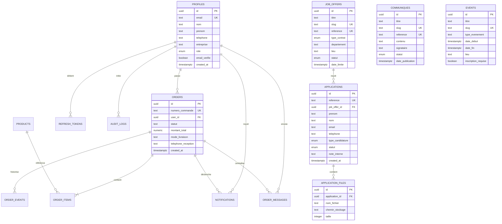

# 🗄️ Base de Données PostgreSQL & Prisma — NOCIBÉ

Schéma de données relationnel PostgreSQL 16 géré avec Prisma ORM, migrations versionnées et types TypeScript automatiques.

---

## 📊 1. Diagramme Entité-Relation Global (ER)



---

## 📑 2. Modèles & Tables Principales

### 2.1 Espace Carrières & Recrutement

#### `JobOffer` (Offres d'emploi et stages)
- `id` (UUID, Clé primaire)
- `titre`, `slug` (Unique), `reference` (Unique)
- `departement` (Production, Maintenance, Qualité, Logistique, Commercial, Support)
- `lieu` (Massé, Cotonou, Parakou, Port)
- `typeContrat` (`CDI`, `CDD`, `STAGE_ACADEMIQUE`, `STAGE_PROFESSIONNEL`, `VIE`, `ALTERNANCE`)
- `statut` (`OUVERT`, `CLOTURE`, `SUSPENDU`)
- `missions` (Json), `profilRecherche` (Text), `competences` (Json)
- `dateLimite` (DateTime)

#### `Application` (Candidatures reçues)
- `id` (UUID, Clé primaire)
- `reference` (Unique, ex: `NOC-REC-2026-XXXX`)
- `jobOfferId` (UUID, optionnel, lié à `JobOffer`)
- `prenom`, `nom`, `email`, `telephone`, `ville`, `pays`
- `typeCandidature` (`OFFRE`, `STAGE_ACADEMIQUE`, `STAGE_PROFESSIONNEL`, `SPONTANEE`)
- `secteurInteret`, `niveauEtudes`, `diplome`, `anneesExperience`, `disponibilite`
- `pretentionsSalariales`, `messageMotivation`
- `statut` (`NOUVELLE`, `EN_REVUE`, `ENTRETIEN`, `RETENUE`, `REJETEE`, `VIVIER`)
- `noteInterne` (Text, accessible uniquement aux administrateurs RH)

#### `ApplicationFile` (Fichiers CV et lettres de motivation)
- Stockés hors de la racine web dans `server/uploads/cv`
- Accessible uniquement via l'endpoint sécurisé admin `GET /api/careers/admin/applications/:id/cv`
- Validation par magic-bytes lors de l'upload (`%PDF-`, `D0 CF 11 E0`, `50 4B 03 04`)

### 2.2 Communication & Événements

#### `Communique` (Communiqués officiels)
- `titre`, `slug` (Unique), `reference` (Unique)
- `resume`, `contenu` (Text), `signataire`
- `statut` (`BROUILLON`, `PUBLIE`, `ARCHIVE`)
- `datePublication`

#### `Event` (Agenda des événements)
- `titre`, `slug` (Unique)
- `typeEvenement` (`SALON_BTP`, `PORTES_OUVERTES`, `SEMINAIRE`, `RSE_COMMUNAUTE`, `FORMATION`)
- `dateDebut`, `dateFin`, `lieu`, `adresse`
- `programme` (Json), `inscriptionRequise`, `lienInscription`

### 2.3 Sécurité, Authentification & Audit

#### `RefreshToken` (Jetons de rafraîchissement)
- `tokenHash` (SHA-256)
- `userId` (FK User)
- `expiresAt`, `revokedAt`, `replacedBy` (Rotation stricte)

#### `AuditLog` (Journal des actions administrateur)
- `userId`, `action`, `resource`, `resourceId`, `details`, `ipAddress`

---

## 🛠️ 3. Commandes d'Administration de la Base

- **Appliquer les migrations en développement** :
  ```bash
  npm --prefix server run db:migrate
  ```
- **Déployer les migrations en production** :
  ```bash
  npx prisma migrate deploy
  ```
- **Peupler la base (Seed)** :
  ```bash
  npm --prefix server run db:seed
  ```
- **Explorer la base graphiquement (Prisma Studio)** :
  ```bash
  npx prisma studio
  ```

&copy; 2026 NOCIBÉ S.A. — Direction des Systèmes d'Information.
