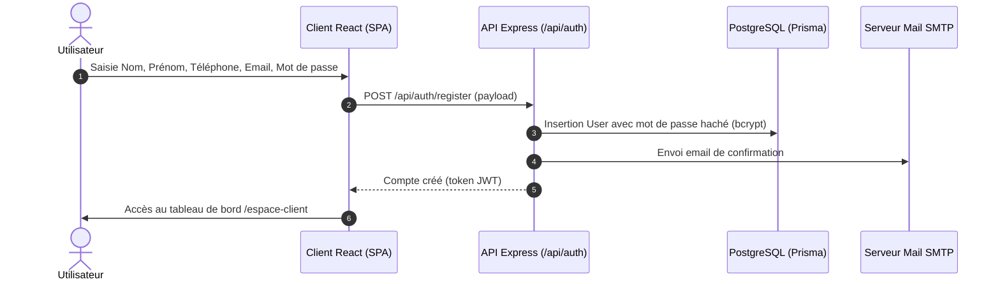
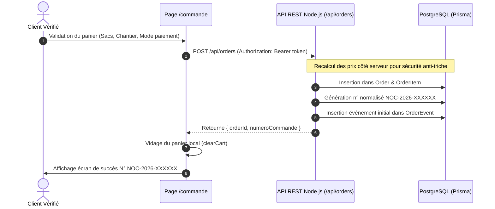

# 💻 Documentation Technique — Plateforme NOCIBÉ

Documentation technique de l'architecture logicielle, des flux de données et des patterns de conception de la plateforme NOCIBÉ Bénin.

---

## 🛠️ 1. Stack Technologique

| Composant | Technologie | Version / Détail |
| :--- | :--- | :--- |
| **Framework UI** | React | 19.0.0 |
| **Bundler & Dev Server** | Vite | 6.2.0 |
| **Typage statique** | TypeScript | 5.8.2 (mode strict) |
| **Styles & Tokens** | Tailwind CSS | v4 avec @tailwindcss/vite |
| **Icons Library** | Phosphor Icons React | v2.1.10 (icônes cohérentes duotone/bold) |
| **Backend API** | Node.js / Express | Express 4, TypeScript, Prisma ORM |
| **Base de Données** | PostgreSQL | PostgreSQL 16 + Prisma Client |
| **Validation schémas** | Zod | v3.x |
| **Routage** | React Router DOM | v7.x |

---

## 📁 2. Arborescence du Projet

```
nocibe_benin/
├── public/                     # Fichiers statiques publics (logo, visuels usine)
├── src/
│   ├── components/             # Composants d'interface modulaires
│   │   ├── auth/               # Gardes de route (RequireAuth, RequireVerifiedUser, RequireAdmin)
│   │   ├── home/               # Sections du site vitrine (CTA flottant, etc.)
│   │   ├── icons/              # Icônes vectorielles industrielles dédiées (Citerne, Sac, Silo)
│   │   ├── layout/             # TopBar, Header vitrine, Footer vitrine
│   │   └── ui/                 # Logo officiel, Badges, Modale de recherche, Calculateur
│   ├── config/                 # Configurations globales du site (coordonnées, réseaux)
│   ├── context/                # Contextes React
│   │   ├── AuthContext.tsx     # Session API JWT, profils et mock de secours
│   │   └── CartContext.tsx     # Panier persistant localStorage
│   ├── data/                   # Jeux de données typés locaux (fallback 100% autonome)
│   │   ├── faq.ts              # Foire aux questions
│   │   ├── news.ts             # Articles et communiqués de presse
│   │   ├── outlets.ts          # Dépôts et points de vente
│   │   ├── partners.ts         # Partenaires institutionnels et BTP
│   │   ├── products.ts         # Catalogue ciments (CPJ 35, CPJ 45, CPA 55...)
│   │   └── projects.ts         # Chantiers de référence au Bénin
│   ├── hooks/                  # Hooks personnalisés avec fallback transparent
│   │   ├── useClientPortal.ts  # Gestion commandes, notifications et messagerie
│   │   ├── useFaq.ts           # Requête FAQ (API ou data locale)
│   │   ├── useNews.ts          # Requête actualités
│   │   ├── useOutlets.ts       # Requête points de distribution
│   │   ├── usePartners.ts      # Requête partenaires
│   │   ├── useProducts.ts      # Requête catalogue ciments
│   │   └── useProjects.ts      # Requête grands chantiers
│   ├── lib/
│   │   └── validations.ts      # Schémas Zod pour formulaires et commandes
│   ├── pages/                  # Pages du site vitrine et du portail
│   │   ├── admin/              # Espace d'administration (Layout, Commandes, Contenu)
│   │   ├── client/             # Espace client (Layout, Dashboard, Commandes, Profil...)
│   │   ├── CartPage.tsx        # Consultation du panier
│   │   ├── CheckoutPage.tsx    # Tunnel de commande en 3 étapes
│   │   ├── HomePage.tsx        # Page d'accueil officielle
│   │   └── ...                 # Pages institutionnelles (Usine, Histoire, RSE...)
│   ├── types/                  # Types TypeScript partagés (Auth, Orders, Products)
│   ├── App.tsx                 # Déclaration des routes et hiérarchie des layouts
│   └── main.tsx                # Point d'entrée de l'application
├── server/
│   ├── prisma/                 # Schéma Prisma PostgreSQL, migrations et seed
│   ├── src/
│   │   ├── config/             # Configuration d'environnement et client Prisma
│   │   ├── middlewares/        # Authentification JWT, vérification rôle admin
│   │   ├── routes/             # Routes REST (auth, products, orders, quotes, contact)
│   │   └── index.ts            # Point d'entrée du serveur Express
│   └── package.json            # Dépendances API (Express, Prisma, bcryptjs, zod)
├── vercel.json                 # Configuration SPA et en-têtes HTTP de sécurité
└── package.json                # Dépendances et scripts de build
```

---

## 🔄 3. Gestion d'État & Résilience

### `AuthContext`
Le contexte d'authentification gère la session utilisateur avec l'API Node.js et persistance sécurisée :
- **Authentification API** : Échange avec l'API Express (`/api/auth`), vérifie les jetons JWT et charge le profil utilisateur (`User`).
- **Mode Démo Autonome** : Permet de tester le parcours client et administrateur sans connectivité active.

### `CartContext`
- Le panier est géré localement dans `localStorage` sous la clé `nocibe_cart_v1`.
- Il conserve les quantités en sacs de 50 kg ou en tonnes.
- Il expose des fonctions de mise à jour, suppression et un tiroir latéral accessible depuis toute la vitrine.

### Système de Fallback Transparent (`useProducts`, `useNews`, etc.)
Chaque hook de données interroge l'API de façon résiliente :
```typescript
try {
  // 1. Tente la requête réseau vers l'API Node.js / PostgreSQL
  const res = await fetch('/api/products');
} catch {
  // 2. Si l'API est indisponible : retourne les données locales de secours de src/data/
}
```
Ce pattern garantit que le site vitrine ne produit **jamais d'écran blanc ni d'erreur bloquante**, même en cas de coupure réseau ou de maintenance de l'API.

---

## 📈 4. Diagrammes de Séquence Mermaid

### Flux d'Authentification & Vérification Email


### Tunnel de Commande & Validation API


---

### Sécurité des Sessions : Cookies HttpOnly & Rotation de Refresh Tokens
L'architecture d'authentification utilise des cookies sécurisés :
- **Cookie d'accès court terme (`nocibe_access_token`)** : Durée de vie 15 minutes, `httpOnly: true`, `SameSite: 'Lax'`, `Secure` en production.
- **Cookie de rafraîchissement long terme (`nocibe_refresh_token`)** : Durée de vie 7 jours, `httpOnly: true`.
- **Modèle `RefreshToken` en base** : Stockage du hash SHA-256 du jeton pour empêcher toute réutilisation après révocation ou changement de mot de passe.
- **Front-end transparent** : Aucun JWT stocké dans `localStorage` (protection contre les failles XSS). Renouvellement automatique transparent via l'intercepteur `api.ts`.

---

## 💼 5. Module Carrières & Téléversement Sécurisé de CV

Le module Carrières (`server/src/routes/careers.routes.ts`) implémente un pipeline de sécurité rigoureux pour le dépôt de candidatures :
- **Validation Zod** sur tous les champs texte (identité, parcours, disponibilité).
- **Honeypot invisible** : Détection silencieuse des bots sans perturber les candidats légitimes.
- **Vérification Binaire (Magic-Bytes) avec Multer** :
  - Les extensions renommées sont rejetées : le serveur inspecte les 8 premiers octets du flux binaire (`%PDF-` pour PDF, `D0 CF 11 E0` pour DOC, `50 4B 03 04` pour DOCX).
- **Stockage hors racine web** : Les fichiers CV sont conservés dans `server/uploads/cv`, inaccessible directement par URL publique.
- **Accès Admin Restreint** : Endpoint `GET /api/careers/admin/applications/:id/cv` protégé par `requireAdmin`.

---

## 📢 6. Module News, Communiqués & Agenda Événements

- **Communiqués Officiels** : Publication avec horodatage certifié, référence unique et mise en page optimisée pour l'impression (CSS `@media print`).
- **Événements & Export Calendrier (.ics)** :
  - Génération RFC 5545 côté client sans dépendance externe.
  - Compatibilité avec Outlook, Google Calendar et Apple Calendar.

---

## ⚡ 7. Performance & Optimisations Vite

- **Code Splitting** : Séparation des bibliothèques externes et icônes dans les options de compilation Rollup (`vendor`, `icons`).
- **Styles optimisés** : Compilation Tailwind CSS v4 sans classes inutilisées en production.
- **Images adaptatives** : Composant `ResponsiveImage` avec balises `<picture>` et chargement différé (`loading="lazy"`).

&copy; 2026 NOCIBÉ S.A. — Architecture & Ingénierie Logicielle.

