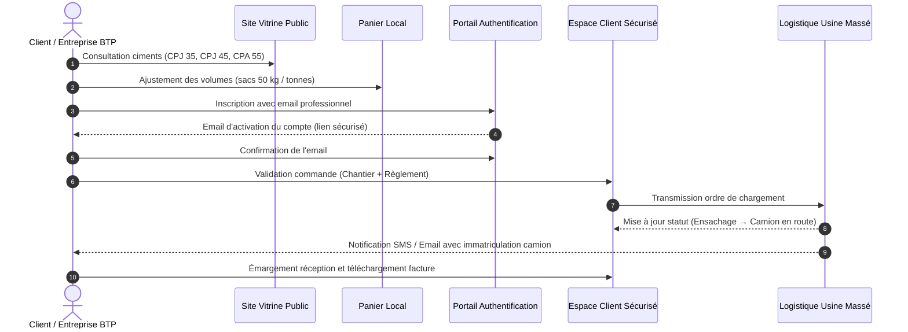

# 📖 Guide Utilisateur & Portail Client NOCIBÉ

Bienvenue sur le guide officiel d'utilisation du portail client de la **Nouvelle Cimenterie du Bénin (NOCIBÉ S.A.)**. Ce document détaille l'ensemble du parcours client, depuis la découverte du catalogue jusqu'à la réception de vos palettes de ciment sur chantier.

---

## 🏗️ 1. Vue d'ensemble du parcours client

---

## 📝 2. Création de Compte & Vérification de l'Email

Pour commander directement auprès de l'usine et bénéficier de la tarification professionnelle, vous devez disposer d'un compte client certifié.

### Étape 2.1 : Formulaire d'inscription
Rendez-vous sur `/espace-client/inscription` et complétez les informations requises :
- **Nom et Prénom** du représentant ou acheteur.
- **Téléphone professionnel** (ex : `+229 97 00 11 22`).
- **Nom de l'entreprise** (Société de BTP, promoteur ou dépôt agréé).
- **Adresse email professionnelle**.
- **Mot de passe** : un indicateur dynamique évalue la robustesse de votre mot de passe (8 caractères minimum, majuscules, chiffres et caractères spéciaux recommandés).

### Étape 2.2 : Confirmation d'adresse email obligatoire
Dès la soumission, vous êtes redirigé vers l'écran de vérification :
1. Consultez votre messagerie à l'adresse indiquée.
2. Ouvrez l'email intitulé **« Confirmez votre adresse email - NOCIBÉ »**.
3. Cliquez sur le bouton orange **« Confirmer mon adresse email »**.
4. Le lien vous redirige automatiquement vers votre tableau de bord sécurisé.

> 💡 **En cas de retard de réception** : Un bouton de réexpédition avec compte à rebours de 60 secondes est disponible sur la page. Vérifiez également votre dossier « Courriers indésirables ».

---

## 🛒 3. Catalogue des Ciments & Panier

Le site vitrine permet de constituer votre panier de commande sans friction :

1. **Fiches Produits Détaillées** (`/produits/:slug`) :
   - Classes de résistance (CPJ 35, CPJ 45, CPA 55, Ciment Spécial Prise Mer).
   - Fiches techniques normées **EN 197-1** et délais d'expédition usine.
   - Sélecteur de quantité en sacs de 50 kg avec conversion automatique en tonnes (1 sac = 0,05 T ; 20 sacs = 1 T).
2. **Calculateur de Béton** (`/produits`) :
   - Estimez le nombre de sacs requis selon votre type d'ouvrage (dallage, poteaux/poutres, fondations armées, mortier de chape).
3. **Tiroir Panier & Page Panier** (`/panier`) :
   - Accessible depuis l'icône de chariot en haut à droite avec badge de décompte.
   - Sauvegardé automatiquement dans la mémoire de votre navigateur.

---

## 🚚 4. Passage de Commande en 3 Étapes (`/commande`)

Lorsque votre panier est prêt, cliquez sur **« Valider la commande »**. Le processus s'effectue en 3 étapes guidées :

### Étape 1 : Récapitulatif du Tonnage
- Vérifiez la ventilation des ciments, les quantités et le montant indicatif TTC en Francs CFA (XOF).

### Étape 2 : Mode de Livraison & Coordonnées Chantier
- **Livraison sur chantier** : Sélectionnez la ville de destination (Cotonou, Abomey-Calavi, Porto-Novo, Parakou, Bohicon, etc.), indiquez le quartier et les repères d'accès pour les camions gros porteurs (30 à 45 tonnes).
- **Retrait direct usine** : Vos propres transporteurs procèdent à l'enlèvement au centre d'ensachage de Massé (Plateau).
- **Téléphone du réceptionnaire** : Indispensable pour coordonner l'arrivée du chauffeur sur le chantier.

### Étape 3 : Modalité de Paiement & Confirmation
- Sélectionnez le mode de règlement convenu :
  - **Virement bancaire certifié** (RIB NOCIBÉ S.A.).
  - **Chèque certifié** remis à la livraison ou à l'enlèvement.
  - **Mobile Money Professionnel** (Moov Money / MTN MoMo).
- Cliquez sur **« Confirmer et transmettre la commande »**.

---

## 🚛 5. Confirmation & Coordination Logistique

Dès la validation :
1. Un numéro officiel de commande est généré sous la forme : `NOC-2026-XXXXXX`.
2. L'ordre de chargement est instantanément transmis au centre de répartition de l'usine de Massé. Vous pouvez contacter la permanence téléphonique au +229 01 47 81 67 78 pour toute consigne spécifique d'accès chantier.

---

## 📊 6. Suivi de Commande en Temps Réel

Dans votre console client (`/espace-client/commandes`) :
- **Statuts logistiques** :
  - `En attente` : Commande enregistrée, en attente de vérification commerciale.
  - `Confirmée usine` : Commande validée par NOCIBÉ S.A.
  - `Ensachage Massé` : Palettes en cours de chargement sur les lignes d'ensachage de l'usine.
  - `Camion en route` : Chauffeur en transit vers votre chantier avec immatriculation mentionnée.
  - `Livrée & Réceptionnée` : Livraison clôturée et signée.
- **Journal logistique** : Historique daté à la minute de chaque étape.
- **Messagerie directe** : Échangez des messages avec l'opérateur logistique affecté à votre commande.
- **Bon de commande & Facture** : Téléchargement direct du PDF pour vos archives comptables.

---

## 👤 7. Gestion du Profil & Chantiers Habituels

Depuis la rubrique **« Mon profil & Chantiers »** (`/espace-client/profil`) :
- **Carnet d'adresses de chantiers** : Enregistrez vos dépôts récurrents pour pré-remplir vos prochaines livraisons en 1 clic.
- **Préférences de notification** : Activez ou désactivez les alertes SMS et notifications par e-mail.
- **Export des données personnelles** : Téléchargement complet au format JSON conformément aux directives de l'APDP Bénin.

---

## 💼 8. Espace Carrières & Candidatures en Ligne

Le portail NOCIBÉ offre un espace dédié aux talents et bâtisseurs :
1. **Hub Carrières** (`/carrieres`) : Chiffres clés RH, piliers de notre politique des ressources humaines et témoignages de nos collaborateurs de Massé.
2. **Offres d'Emploi** (`/carrieres/offres`) : Moteur de recherche et filtres par contrat (CDI, CDD, etc.), département et ville. Fiches détaillées avec missions, compétences et avantages sociaux.
3. **Filière Stages & Étudiants** (`/carrieres/stages`) : Deux parcours spécialisés : *Stages académiques / PFE* (1 à 6 mois) et *Stages professionnels pré-embauche* (6 à 12 mois), en partenariat avec les écoles d'ingénieurs (EPAC, 2iE, INP-HB).
4. **Formulaire de Candidature** (`/carrieres/postuler`) :
   - Parcours guidé en 5 étapes (Identité, Profil, Parcours, Téléversement de CV et Validation).
   - Formats acceptés : PDF ou Word (< 5 Mo).
   - Sauvegarde automatique en cours de saisie pour éviter la perte de données.
   - Délivrance d'un numéro d'accusé de réception unique (ex : `NOC-REC-2026-XXXX`).

---

## 📢 9. Communiqués Officiels & Événements

1. **Communiqués Officiels** (`/actualites/communiques`) :
   - Consultation des prises de parole officielles, notes techniques et déclarations de la Direction Générale.
   - Page dédiée avec mise en page papier à en-tête officielle, signataire et bouton d'impression propre (PDF).
2. **Agenda & Événements** (`/actualites/evenements`) :
   - Calendrier des salons BTP, journées portes ouvertes de l'usine de Massé, campagnes de reboisement et séminaires distributeurs.
   - Fiches détaillées avec programme et bouton **« Ajouter à mon calendrier (.ics) »** pour intégration directe dans Outlook, Google Calendar ou Apple Calendar.

---

## 📜 10. Le Mot du Directeur Général (`/mot-du-directeur`)

Accessible depuis le menu « À propos » et la page d'accueil, cette page présente la vision stratégique de la direction générale de la Nouvelle Cimenterie du Bénin : engagement pour l'autosuffisance cimentière, décarbonation progressive et développement économique des communautés locales.

&copy; 2026 NOCIBÉ S.A. — Service Relations Clients, RH & Logistique Massé.

